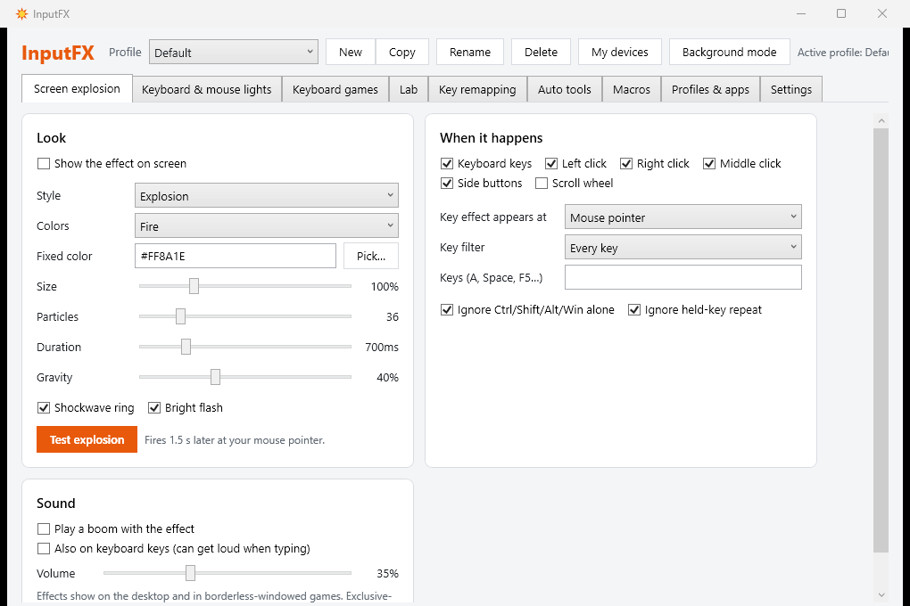
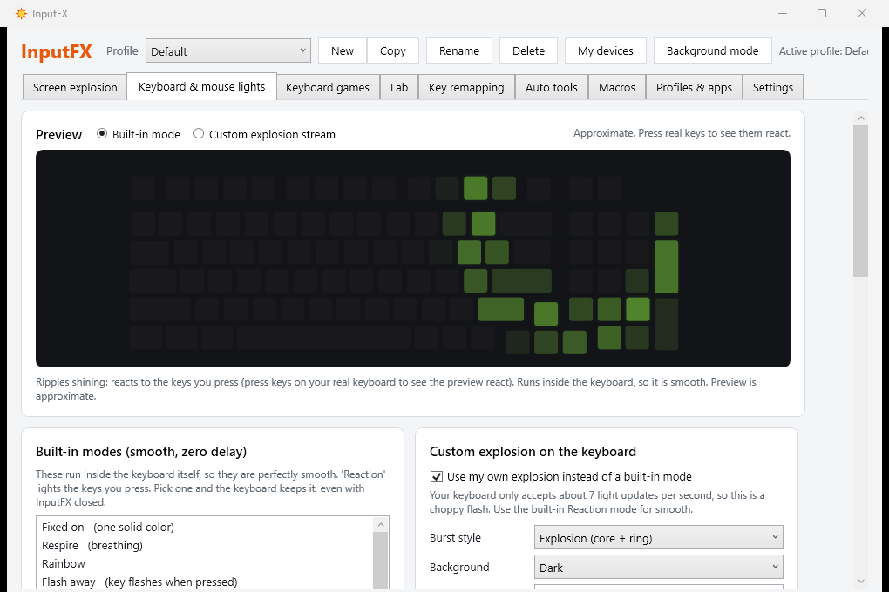
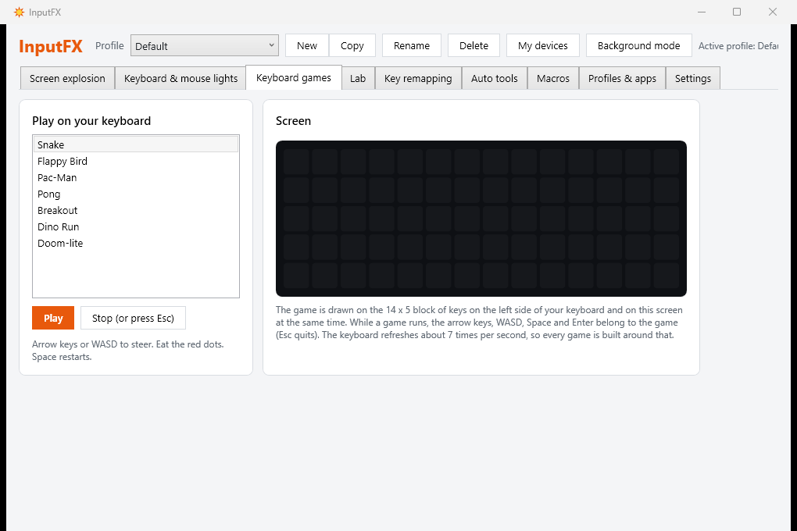

# InputFX

A small Windows tray app that makes your keyboard and mouse feel alive: particle explosions on screen for every key press and click, lighting on the keyboard and mouse themselves, key remapping, macros, per-app profiles, music-reactive lights and a few tiny games played on the keyboard's LEDs.

InputFX runs fully offline. It makes no network connections, has no telemetry and never checks for updates on its own.



| Keyboard and mouse lighting | Games on the keyboard LEDs |
| --- | --- |
|  |  |

## Features

- **Screen explosions**: six burst styles (Explosion, Fireworks, Sparks, Confetti, Shockwave, Pixels) and six color modes, at the cursor, the text caret, the window center or a random spot, with an optional synthesized sound.
- **Keyboard lighting** (supported keyboards): per-key bursts from the key you press, calm backgrounds, typing-rhythm glow, a slowly growing "garden", music-reactive bars, and the keyboard's own 21 built-in modes with speed and brightness.
- **Mouse lighting** (supported mice): the mouse's 14 built-in backlight modes, plus a live click pulse in 14 shapes (Flash, Glow, Double, Strobe, Heartbeat and more) and music breathing.
- **Remapping and macros**: remap any key or the mouse's middle and side buttons to another key, text, a program, a macro or a profile switch. Macros are short scripts (press, down, up, text, delay, click, run) that run once, while held, or toggled.
- **Per-app profiles**: every profile has its own effects, lighting, remaps and macros, and switches automatically when a listed app comes to the front.
- **Alerts as light**: a flashing taskbar button, low battery or a CPU running hot pulses the keyboard in a color you recognize.
- **Cross-device ripples**: a click sends a wave down to the keyboard, a key press sends one up to the cursor.
- **Seven mini-games on the keyboard LEDs**: Snake, Flappy Bird, Pong, Breakout, Dino Run, Pac-Man and Doom-lite, mirrored in a larger window on screen.
- **Auto tools**: an auto clicker and auto key with a hotkey, speed and limit, protected by the game safety lock below.
- **Background mode**: one click pauses overlays, lighting, audio capture and games while remaps, macros and auto tools keep working at almost no power cost.
- **Panic key**: Ctrl+Alt+Shift+F12 instantly pauses everything.

## Supported devices

Every keyboard and mouse works with the screen effects, remapping, macros, profiles, auto tools and the on-screen game view. Lighting on the device itself needs a device whose protocol InputFX knows:

| Device | USB ID | On-device lighting |
| --- | --- | --- |
| EXCALIBUR / White Shark K916 keyboard (SINOWEALTH) | 258A:019D | Yes: per-key streaming, built-in modes, games |
| EXCALIBUR keyboard, wireless dongle (SINOWEALTH) | 258A:0150 | Detected as supported |
| Galahad GM-5007 "USB GAMING MOUSE" | 30FA:1440 | Yes: built-in modes, live click pulse |
| Any other keyboard or mouse | | No: screen effects, remaps, macros, auto tools, games on screen |

**Your device isn't listed?** Open InputFX, go to **My devices**, press **Copy device report**, then [open a device support request](../../issues/new?template=device-support.yml) and paste it in. The report holds only the device names, USB IDs and your Windows version.

Close the vendor apps (EXCALIBUR Software, Gaming Mouse 3.0) before using the lights: only one program can control a device at a time.

## Automation safety policy

The auto clicker, turbo, key repeater and repeating macros switch off and refuse to start while any of these is running:

- a known online game (Valorant, CS2, Fortnite, Apex, League of Legends and many more),
- a program inside a game library folder (Steam, Epic, Riot, Ubisoft, GOG, Battle.net, EA),
- an anti-cheat service (Easy Anti-Cheat, BattlEye, Vanguard, FACEIT and others),
- any full-screen game.

These built-in rules cannot be turned off. You can only add more programs to the list. InputFX does not and will not include aim assistance, recoil control, trigger bots, randomized "human-like" timing, anti-AFK tools or anything else that gives an unfair edge in online games.

## Install

1. Install the [.NET 10 Desktop Runtime](https://dotnet.microsoft.com/download/dotnet/10.0) (not needed for the self-contained download).
2. Download the latest zip from [Releases](../../releases) and unzip it anywhere.
3. Run `InputFX.exe`. It lives in the tray, bottom-right. The first run opens **My devices** so you can see what your keyboard and mouse support.

Settings are stored in `%APPDATA%\InputFX\config.json`, with a log in `inputfx.log` next to it.

Command-line options:

- `--minimized` starts in the tray.
- `--tab N` opens the settings window on tab N.
- `--selftest` runs headless checks (games, burst styles, mouse pulse shapes, audio, device scan) and writes `selftest.txt` next to the settings.

## Build from source

Requires Windows 10 or 11 and the [.NET 10 SDK](https://dotnet.microsoft.com/download/dotnet/10.0).

```powershell
git clone https://github.com/hunterprom/InputFX.git
cd InputFX\src\InputFX
dotnet build -c Release
dotnet publish -c Release -o ..\..\dist --self-contained false
..\..\dist\InputFX.exe --selftest
```

Quit a running InputFX first, or the publish step can't replace the locked exe.

## Device protocol

[docs/PROTOCOL.md](docs/PROTOCOL.md) describes what InputFX sends to the supported keyboard and mouse. InputFX only sends commands that were captured from the vendors' own apps, or replays of them with one documented value changed. It never invents writes to device memory.

`src/InputFX/Assets/kb_cfg04.bin`, `kb_cfg84.bin` and `mouse_replay.bin` are captured device configuration frames. They are included only so InputFX can talk to the hardware (interoperability) and contain no vendor program code. The key layout and the lighting animations are InputFX's own work.

## Disclaimer

Changing a mode on a supported keyboard or mouse writes to the device's own memory. This works on the hardware it was tested on, but you use it **at your own risk**: the authors are not responsible for damage to your device, lost settings or voided warranties. Keep these writes rare; InputFX only makes them when you ask for a mode or a profile changes.

InputFX is not affiliated with or endorsed by SINOWEALTH, EXCALIBUR, White Shark, Galahad or any other vendor. Product names are trademarks of their owners.

## License

[MIT](LICENSE)
